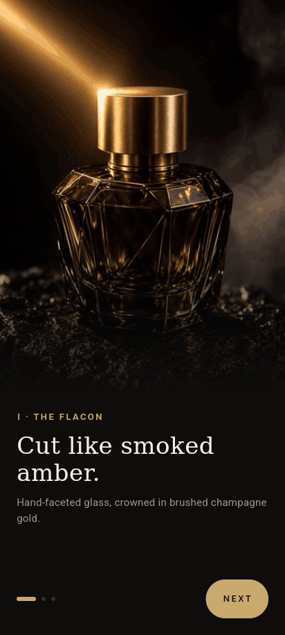
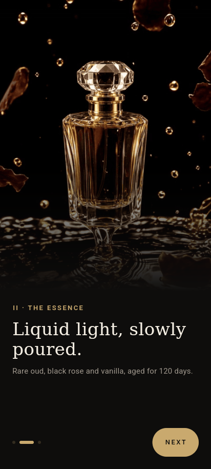
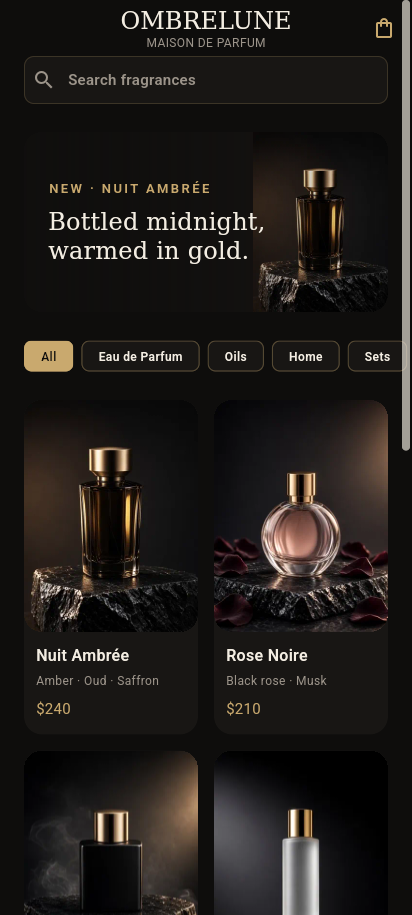
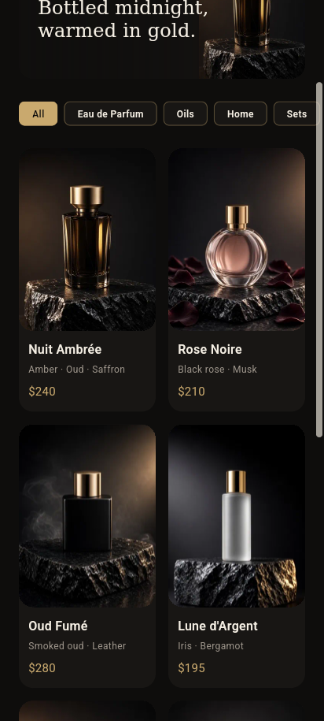

# OMBRELUNE · Maison de Parfum

Nightly Flutter showcase #1 (2026-10-18). **OMBRELUNE** is a *fictional* luxury fragrance house, "the shadow of the moon". Its world is smoked-amber glass, brushed champagne gold and obsidian stone, shot like a midnight perfume ad. It is not a real brand.

| Onboarding 1 | Onboarding 2 | Onboarding 3 | Home | Grid |
|---|---|---|---|---|
|  |  |  |  |  |


## Brand
- **Palette:** Obsidian `#0E0D0C`, Surface `#181614`, Champagne Gold `#C9A96E`, Ivory `#F3EDE2`, Mist `#9C948A`
- **Type:** system serif for display copy, sans with wide tracking for labels

## Features
- 3 onboarding screens with looping product-film GIFs, animated page indicator, Next/Get started
- Home: brand app bar, search (`AppTextField`), featured banner, category chips, lazy product grid, press-scale and Hero transition to a detail page

## Architecture
```
lib/
  core/        constants, di, routing, theme (tokens), utils, widgets (AppButton, AppText, AppTextField)
  features/
    onboarding/{data,domain,presentation}
    home/{data,domain,presentation}
```
- **State management: `provider`** (ChangeNotifier + `context.select`), picked at random for this night. See `../state-mgmt-log.md`.
- The domain defines `ProductRepository` and `OnboardingRepository` interfaces, and the data layer provides the local implementations.
- `ServiceLocator` is a tiny composition root with no DI package.

## Performance decisions
- `const` constructors throughout. Builds are split into small widget classes, never helper methods.
- Narrow rebuilds: `context.select` for page index, `isLast`, category, products and the featured item, so only the dots, button, chips or grid rebuild.
- GIFs sit in a `RepaintBoundary`, and `TickerMode(enabled: active)` pauses off-screen GIFs so they stop decoding frames.
- `cacheWidth`/`cacheHeight` come from the logical size × DPR (`ImageCacheSize`), so images decode at display size.
- Onboarding GIFs and the first hero image are precached before they show.
- `CustomScrollView` with `SliverGrid.builder`, and keyed items.
- Assets: product images are WebP at 360×480 (about 2× card size, ~135 KB total). GIFs are 420 px wide, 10 fps, 3.2 s and 48-colour palettes (~2.6–3.0 MB each).
- Strict analysis (`strict-casts`, `strict-inference`, `strict-raw-types`, `always_specify_types`, `prefer_const_*`, and more), with zero issues.
- Release APK (split per ABI): arm64 25.6 MB, armeabi-v7a 22.9 MB, x86_64 27.1 MB.

## Run
```bash
flutter pub get
flutter run            # Android emulator/device
flutter test
```
Only dependency: `provider` (MIT). Licensed under MIT, see LICENSE.
